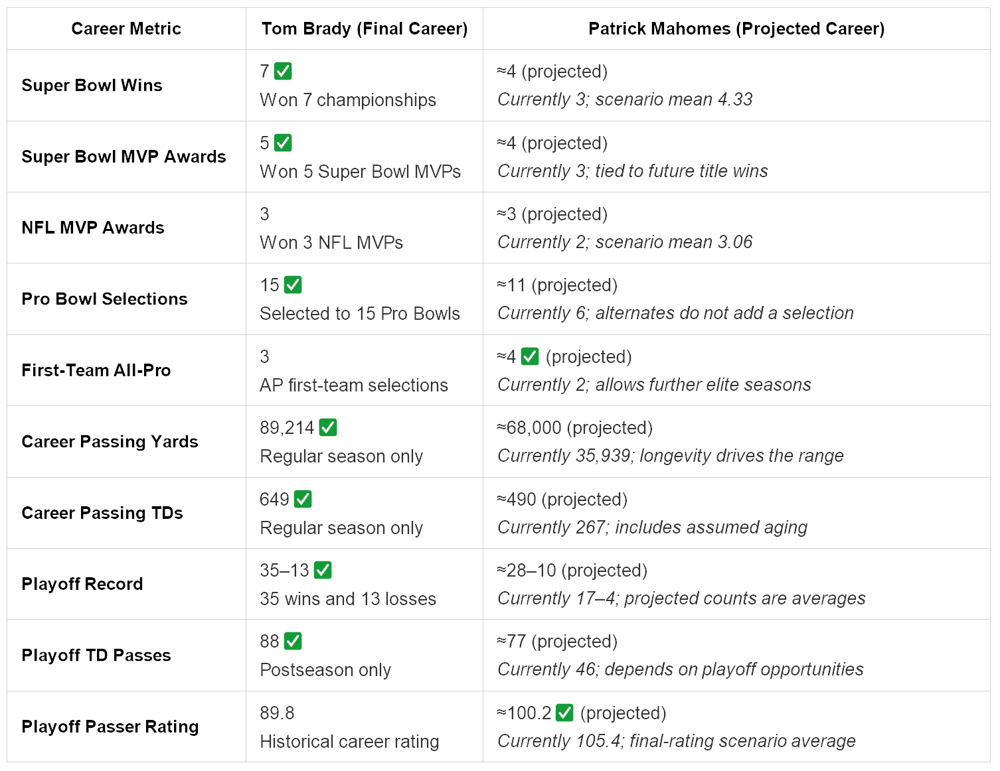
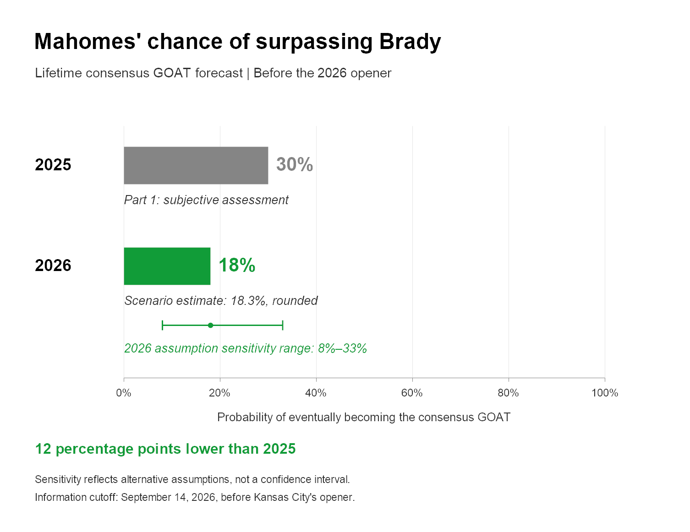

# Forecasting the NFL GOAT with Artificial Intelligence: The 2026 Update

Last year I wrote an article that used an AI system to research and predict the probability of Patrick Mahomes surpassing Tom Brady as the greatest NFL quarterback. Last year's [Forecasting the NFL GOAT Quarterback with Artificial Intelligence](https://dev.to/bartczernicki/forecasting-the-goat-with-artificial-intelligence-n88) put Patrick Mahomes' chance of eventually surpassing Tom Brady at **30%**. The approach used ChatGPT's AI deep research, career projections, and a judgment about how fans and analysts might ultimately compare their legacies.

Part 1 introduced the research concepts and their limitations. This follow-up concentrates on what changed, makes the probability calculation explicit, and refreshes the same ten career metrics.

A few notes before reading the AI analysis:

* This year I updated the analysis after the 2025-2026 season, before Kansas City's Monday Night Football game. Why the wait? As you may note, Patrick Mahomes is coming off of a major injury and I wanted to have an accurate sense of the latest information. Information cutoff: September 14, 2026, before Kansas City's season opener. Career statistics include the completed 2025 NFL season; recovery and roster information extend through this cutoff. No performance from Kansas City's 2026 opener enters the analysis.
* The 2026 updated assessment uses agentic OpenAI Codex (Deep Research doesn't exist anymore) as the research harness.
* Now that we have two data points, I asked AI to create a chart. It added an assumption sensitivity range alongside the point estimate.

Note: Everything below this line has been generated by OpenAI's Codex AI system using GPT-6-Astra (Ultra mode).

## What changed after the 2025 season?

Mahomes finished 2025 with **3,587 passing yards, 22 touchdowns, 11 interceptions, and an 89.6 passer rating in 14 games**. [NFL career statistics](https://www.nfl.com/players/patrick-mahomes/stats/career)

His career now stands at **35,939 regular-season passing yards and 267 touchdowns**. The championship and postseason baselines did not advance: three Super Bowl wins, three Super Bowl MVPs, a 17–4 playoff record, and 46 playoff touchdown passes. [Chiefs player biography](https://www.chiefs.com/team/players-roster/patrick-mahomes/)

Kansas City finished **6–11**, scoring 362 points and allowing 328. That **+34 differential** complicates any simple claim that the team had collapsed. The Chiefs also went **1–9 in games decided by eight points or fewer**. Those totals reconcile against the [completed schedule](https://www.chiefs.com/schedule/2025/) and the team's [season-opening preview](https://www.chiefs.com/news/five-things-to-watch-on-monday-broncos-vs-chiefs).

My interpretation is that another poor year is possible, but the win-loss record alone overstates the evidence for permanent decline. A rebound in close games is plausible; it is not guaranteed.

The larger new uncertainty is physical. Mahomes injured his left knee in the December 14 loss to the Chargers that eliminated Kansas City. He underwent surgery the next day; NFL reporting identified repairs to both the ACL and LCL. The team was already losing its postseason opportunity when the injury occurred, so the entire season cannot be attributed to his absence. [NFL surgery report](https://amp.nfl.com/news/chiefs-qb-patrick-mahomes-undergoes-successful-surgery-to-repair-acl-lcl)

There is also encouraging current evidence. The September 12 injury report records full participation with no game designation, and the NFL reports that Mahomes is cleared to start against Denver. Clearance resolves availability for the opener; it does not establish restored mobility or years of future durability. [Chiefs injury report](https://www.chiefs.com/news/week-1-injury-report-broncos-vs-chiefs-2026), [NFL return update](https://amp.nfl.com/news/chiefs-qb-patrick-mahomes-knee-has-no-injury-status-cleared-for-comeback-monday-night-vs-broncos)

The surrounding team has changed, too. Eric Bieniemy returned as offensive coordinator, Travis Kelce returned for 2026, and Kansas City added Kenneth Walker while trading Trent McDuffie. These moves create plausible improvement paths and new uncertainties. They do not establish how competitive the roster will be a decade from now. [Coaching announcement](https://www.chiefs.com/news/chiefs-name-eric-bieniemy-as-offensive-coordinator), [Kelce announcement](https://www.chiefs.com/news/travis-kelce-to-return-for-14th-season), [roster transactions](https://www.chiefs.com/news/catching-up-on-the-chiefs-roster-moves-as-the-nfl-league-year-begins-x3713)

## Updated career projections

The career projections summarize the **central scenarios and weights explained below**. For every metric, I assign an illustrative average within each scenario, then calculate its weighted average. These profiles are assumptions, not empirical estimates of quarterback aging.

*Historical baselines: [Chiefs biography](https://www.chiefs.com/team/players-roster/patrick-mahomes/), [NFL Brady retirement summary](https://amp.nfl.com/news/tom-brady-retirement-23-seasons-in-nfl-buccaneers-patriots), and [postseason comparison](https://www.statmuse.com/nfl/ask/brady-mahomes-playoff-record). Mahomes' Pro Bowl total remains six; the [2026 announcement](https://www.chiefs.com/news/four-chiefs-named-to-the-2026-pro-bowl-games) lists him as an alternate.*

## Turning the GOAT question into explicit scenarios

The question remains: **When Mahomes' career is over, how likely is broad agreement among fans and analysts that he ranks above Brady?** There is no official GOAT award or fixed voting population. The forecast describes an eventual legacy judgment, not simply the probability of winning eight championships.

I divide the remaining possibilities into four mutually exclusive groups based on final Super Bowl wins. Each receives a weight and a conditional chance of achieving consensus GOAT status. The latter considers the wider career profile, including awards, longevity, production, and playoff performance.

**Every weight and conditional probability below is a judgment call.** The sources establish the evidence; they do not supply these percentages. This is a reproducible scenario assessment, not a fitted statistical model or a Monte Carlo simulation.

| Final Super Bowl wins | Illustrative remaining seasons | Scenario weight | GOAT chance within scenario | Contribution to total |
|---|---:|---:|---:|---:|
| 3–4 | 7 | 60% | 2% | 1.2 percentage points |
| 5 | 10 | 24% | 25% | 6.0 percentage points |
| 6 | 12 | 11% | 60% | 6.6 percentage points |
| 7+ | 14 | 5% | 90% | 4.5 percentage points |

The **3–4-title group** receives the largest weight because a lost postseason opportunity, uncertain sustained recovery, and finite career length make repeated future championships difficult. It includes early retirement as well as long careers with limited further team success. Seven remaining seasons is an illustrative average, not a minimum.

The **five-title group** assumes a successful return, about another decade of play, and two additional championships. That would create a serious GOAT argument, while leaving a substantial championship gap.

The illustrative **six-title and seven-plus profiles** assume increasingly exceptional longevity and repeated championship contention. Their careers extend into the early or mid-forties; the titles could also arrive sooner. Even seven titles do not mechanically settle a debate about eras, supporting casts, and individual performance.

This still assigns **40% to at least two more championships**, **16% to at least three**, and **5% to at least four**. It retains considerable upside, informed by Mahomes' established postseason ceiling and the possibility of a strong recovery. The evidence supports those possibilities; the exact allocations remain contestable.

The conditional approach keeps achievements connected: the strongest championship outcomes also carry longer careers and stronger statistical profiles. It avoids treating recovery, playoff appearances, awards, and titles as independent events.

## What would change the forecast next?

A sustained return to effective movement, strong passing production, and reliable availability would support shifting weight toward the upper scenarios. So would evidence that the offense can remain productive as personnel change. One impressive game would provide much less information than a healthy, effective season.

Persistent limitations, further missed time, or declining effectiveness would push weight toward the lower group. Another missed postseason would consume another championship opportunity, although the underlying performance would still matter when assessing future prospects.

A championship would directly change the starting point. It would also justify rebuilding the scenario distribution instead of adding a fixed number of percentage points. Awards and postseason efficiency would help distinguish team success from Mahomes' individual contribution.

Sources and reproducibility

Sources were checked September 14, 2026, subject to the pre-opener cutoff.

- Bart Czernicki, [Part 1](https://dev.to/bartczernicki/forecasting-the-goat-with-artificial-intelligence-n88), March 11, 2025; edited March 14.
- Chiefs and NFL, [Mahomes biography](https://www.chiefs.com/team/players-roster/patrick-mahomes/) and [season statistics](https://www.nfl.com/players/patrick-mahomes/stats/career), historical tables.
- Chiefs, [2025 schedule](https://www.chiefs.com/schedule/2025/), historical table; [Week 1 preview](https://www.chiefs.com/news/five-things-to-watch-on-monday-broncos-vs-chiefs), September 13, 2026.
- NFL, [surgery report](https://amp.nfl.com/news/chiefs-qb-patrick-mahomes-undergoes-successful-surgery-to-repair-acl-lcl), December 15, 2025; [return update](https://amp.nfl.com/news/chiefs-qb-patrick-mahomes-knee-has-no-injury-status-cleared-for-comeback-monday-night-vs-broncos), September 12, 2026.
- Chiefs, [injury report](https://www.chiefs.com/news/week-1-injury-report-broncos-vs-chiefs-2026), September 12, 2026.
- Chiefs, [Bieniemy appointment](https://www.chiefs.com/news/chiefs-name-eric-bieniemy-as-offensive-coordinator), January 23; [Kelce return](https://www.chiefs.com/news/travis-kelce-to-return-for-14th-season), March 11; [roster moves](https://www.chiefs.com/news/catching-up-on-the-chiefs-roster-moves-as-the-nfl-league-year-begins-x3713), updated through March 20, 2026.
- Kevin Patra, NFL, [Brady retirement summary](https://amp.nfl.com/news/tom-brady-retirement-23-seasons-in-nfl-buccaneers-patriots), February 1, 2023; StatMuse, [playoff comparison](https://www.statmuse.com/nfl/ask/brady-mahomes-playoff-record).
- Chiefs, [Pro Bowl selections](https://www.chiefs.com/news/four-chiefs-named-to-the-2026-pro-bowl-games), December 23, 2025.

## Final probability assessment

The updated assessment is **approximately 18%**, with an **8%–33% assumption sensitivity range**. That leaves a meaningful path to the top, but the central outlook is less favorable. These are subjective estimates, not measured frequencies or betting odds.

The calculation is:

**P(GOAT) = Σ[P(scenario) × P(GOAT | scenario)]**

**(0.60 × 0.02) + (0.24 × 0.25) + (0.11 × 0.60) + (0.05 × 0.90) = 0.183**

That produces **18.3%, rounded to 18%**.

### Sensitivity of the estimate

The arithmetic is exact given the assumptions. The assumptions are uncertain.

For sensitivity analysis, I change both the distribution of football outcomes and the standards that might shape the eventual legacy judgment. Each row below follows the same scenario order: **3–4 / 5 / 6 / 7+ titles**.

| Assumption case | Scenario weights | Conditional GOAT chances | Calculated result |
|---|---|---|---:|
| Pessimistic | 72% / 20% / 6% / 2% | 1% / 15% / 45% / 80% | 8.02% |
| Central | 60% / 24% / 11% / 5% | 2% / 25% / 60% / 90% | 18.30% |
| Optimistic | 45% / 28% / 17% / 10% | 4% / 35% / 70% / 95% | 33.00% |

The resulting **8%–33% assumption sensitivity range is not a confidence interval**. It does not mean a statistical procedure has located the true probability with a stated coverage rate. It shows how far the answer moves under these selected alternative judgments.

Changing only the football scenario weights gives **11.84%–27.10%**. Changing only the conditional legacy judgments gives **13.15%–23.25%**. Both sources of uncertainty matter, and other reasonable assumptions could produce results outside the displayed range.

| Forecast | Headline estimate | Assumption sensitivity range |
|---|---:|---|
| 2025, Part 1 | 30% | Not reported |
| 2026, this update | 18% | 8%–33% |

*The bars use rounded headline estimates: a decrease of 12 percentage points. The unrounded calculation changes by 11.7 points.*

The 2025 estimate remains the original **30%**; I have not reconstructed it using today's method. Consequently, this comparison reflects **both new evidence and a methodological change**. It cannot isolate the effect of the 2025 season, demonstrate improved forecasting skill, or establish that last year's estimate was wrong. The eventual outcome remains unresolved.

That is the practical value of this AI-assisted update: current evidence, visible assumptions, and calculations that can be inspected. Both the remaining football career and the eventual public judgment remain uncertain.

**My updated estimate of Mahomes eventually surpassing Brady as the consensus NFL GOAT quarterback is 18%.**
