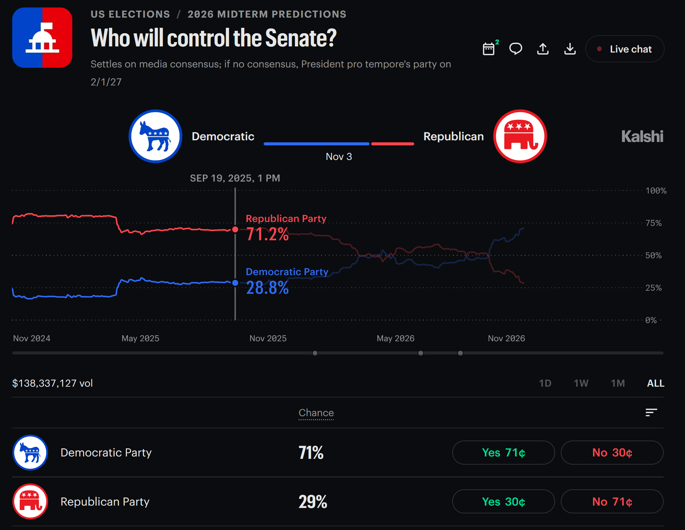
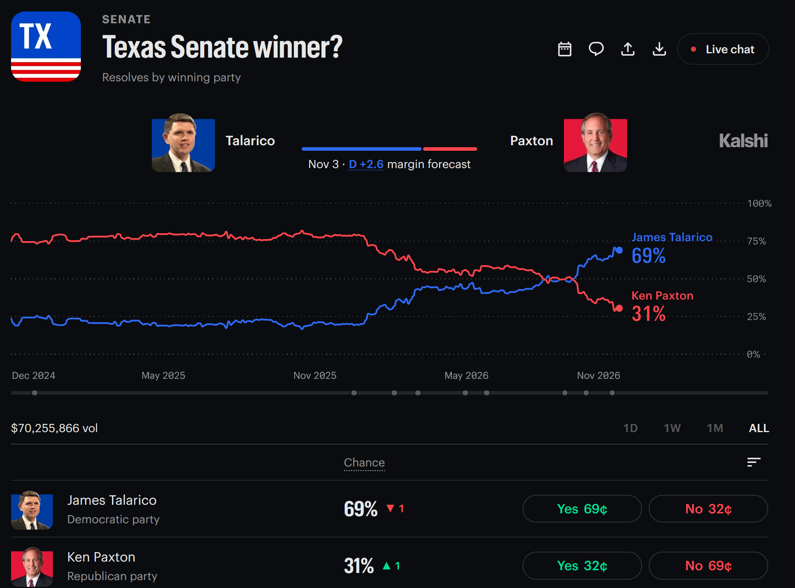
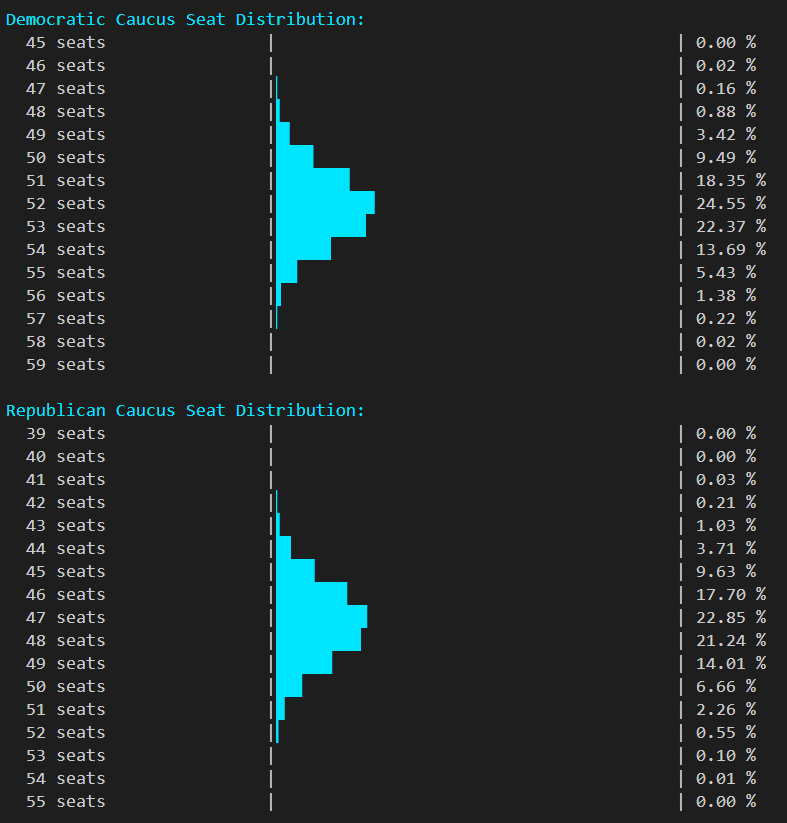
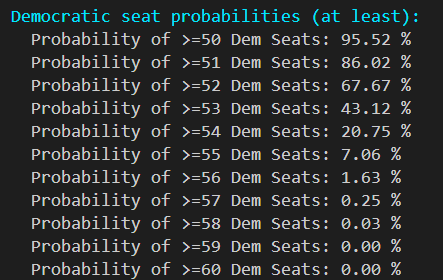
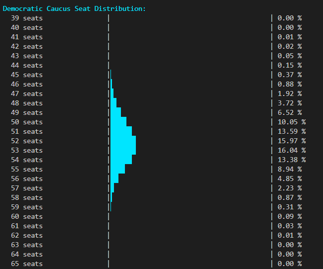
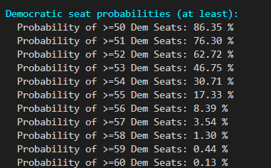

# Forecasting the U.S. Senate with Prediction Markets and Monte Carlo Simulations  

Prediction markets price both individual Senate races and overall Senate control. This article tests whether those prices tell the same story. We combine individual race probabilities with Monte Carlo simulations and compare the resulting chance of Senate control with the overall market contract.

As of **11.01.2026**, Kalshi's overall contract gives Democrats a **71%** chance of controlling the Senate, while our simulations using its individual race probabilities estimate roughly **76%–86%**. We'll walk through the inputs, compare independent and correlated simulations, and explore whether that gap suggests a potential market opportunity.

## Background on the 2026 Senate Races

**Key Information:** 
- **Current balance of power:** There are a total of 100 U.S. senators (2 senators for every state in the U.S.). Republicans hold **53 seats**, compared with **45 Democrats and two independents who caucus with them**, giving the Democratic bloc 47 seats. ([Ballotpedia](https://ballotpedia.org/United_States_Senate_elections,_2026))
- **Senate Election map:** On 11.03.2026, voters will decide **35 of the Senate's 100 open seats**: a total of 33 regular elections plus special Senate elections in Florida and Ohio. Republicans defend 22 seats and Democrats defend 13. ([Ballotpedia](https://ballotpedia.org/United_States_Senate_elections,_2026))
- **What Democrats need:** A **net gain of four seats** brings their bloc to 51 and gives them control. Holding all their current seats means flipping four Republican seats; each Democratic loss requires another pickup. ([Inside Elections](https://insideelections.com/ratings/senate/))
- **What Republicans need:** **50 seats are enough to retain control**, because Republican Vice President J.D. Vance can break ties. Republicans can therefore lose three seats net and still control the chamber at 50-50. ([U.S. Senate](https://www.senate.gov/legislative/TieVotes.htm))

In this article, we will demonstrate a forecast of the 35 US Senate race outcomes & combine the forecasts with the **65 existing US Senate seats not on the ballot**. This will determine the final 100 US Senate totals and each party's probability of controlling the Senate.

## Background on Prediction Markets

Prediction markets such as Polymarket and Kalshi let people buy and sell contracts on questions like, "Will this candidate win?" Trading turns those competing views into a probability that changes as new information arrives. A market resolves when it confirms the outcome under its rules and settles the contracts.

*Workflow of Kalshi Market Contracts. Image credit: [Trade the Outcome](https://www.tradetheoutcome.com/wp-content/uploads/2026/07/How-Kalshi-YES-NO-Contract-Payoffs-Work-768x512.jpg).*

**Key Concepts:**

- **Prices represent probabilities:** A "YES" contract priced at **\$0.65 implies about a 65% chance** of the event happening. In a standard binary market, that contract pays \$1 if the event happens and \$0 if it does not. The percentage describes the chance of winning, rather than the candidate's expected share of the vote. ([Polymarket overview](https://help.polymarket.com/en/articles/13364060-what-is-polymarket))
- **You can sell before the result:** Like stocks, contract prices rise and fall. Buying at \$0.65 and selling at \$0.80 earns \$0.15 per contract before fees; selling at \$0.45 instead loses \$0.20 (\$0.65 - \$0.45 = \$0.20). Traders can take a profit or limit a loss before resolution, provided another trader will buy. ([Polymarket trading guide](https://legacy-docs.polymarket.com/faq/trading))
- **Collective Intelligence:** Traders bring different polls, news, expertise and local knowledge. Their buying and selling combines that information into one price: the **wisdom of markets**. Someone who thinks the price is wrong has an incentive to trade against it, helping the market update. ([Polymarket overview](https://help.polymarket.com/en/articles/13364060-what-is-polymarket))

  

- **People put money behind their beliefs:** Financial stakes give a forecast more accountability than a casual opinion. This connects with the core them in Annie Duke's book *Thinking in Bets*. That makes prediction market prices useful evidence, as traders are materialy invested in their forecast beliefs. ([Annie Duke on thinking in bets](https://www.annieduke.com/thinking-in-bets/))

  

    
  

- **Calibration means the percentages match reality:** Across many comparable events assigned a **70% chance**, roughly **70 out of 100 should happen** (within statistical boundary) in a well-calibrated market. If the forecast is way over in its forecast versus the reality, it is considered overconfident. Conversely, a forecast that is way under its forecast is considered underconfident. ([Research on market calibration, 2026](https://pubmed.ncbi.nlm.nih.gov/42896054/))

  

- **Forecasts often improve closer to resolution:** Kalshi's own August 2026 study of more than 2.2 million resolved markets found prices generally well calibrated near resolution, with forecast errors declining as markets approached their close. This supports using near-election prices as inputs, while calibration still needs to be checked against actual outcomes. ([Kalshi Research, 2026](https://kalshi.com/research/publications/calibration))

**U.S. Senate Races on Prediction Markets**

Prediction markets offer both **macro contracts** for the overall election and **detailed contracts** for each individual Senate race:

- **Overall Senate control:** This contract asks which party will control the U.S. Senate. The 11.01.2026 screenshot below shows a 71% chance for Democrats and 29% for Republicans.

  

    
  

- **Individual Senate races:** Separate contracts cover each state's race. For example, the 11.01.2026 Texas screenshot shows James Talarico at 69% and Ken Paxton at 31%.

  

    
  

For our Senate forecast, individual race prices provide the starting estimates. We test whether combining those probabilities produces a Senate-control estimate consistent with the overall contract. A difference could point to potential value, depending on the model assumptions; proximity to Election Day alone does not establish that the prices are well calibrated.

## Monte Carlo Simulations & Forecast Methodology

A **Monte Carlo simulation** runs a model thousands (or more) of times, using random draws to represent uncertainty. Each run produces one possible future. For our Senate forecast, one run represents an entire election: who wins each race, how many seats each party holds, and who controls the chamber.

*A Monte Carlo simulation lets us explore what could happen before the real event, much like checking a ladder's stability before climbing.*

**Monte Carlo Basics:**

- **Probabilities guide the random draws:** In a simple independent simulation, a candidate with a 70% chance wins when a random number between 0 and 1 falls below 0.70. Across many runs, that candidate wins roughly seven times out of ten, while still losing in some simulated elections.
- **Many runs produce a range of outcomes:** Some simulated elections produce a narrow majority; others produce a larger victory for either party. The result is a **distribution of possible seat totals**, showing both common and less likely outcomes.
- **Count how often an outcome happens:** As an illustration, if Democrats control the Senate in 65,000 of 100,000 simulations, the model estimates a 65% chance of Democratic control. More runs reduce random variation in this estimate; the quality of the forecast still depends on its inputs and assumptions.

*This sales example illustrates the same principle: repeated simulations produce a range of possible results.*

**U.S. Senate Forecast Methodology:**

1. **Start with market probabilities:** Use Kalshi's **11.01.2026** estimates for the 35 races as inputs. Hold the 65 Senate seats not on the ballot fixed.
2. **Simulate a complete election:** Generate winners for all 35 races. An independent baseline treats each race separately; a correlated version also includes shared influences that can move several races together.
3. **Count seats and determine control:** Add the simulated winners to the existing seats, counting independents according to their caucus alignment. Democrats need a bloc of 51; Republicans can retain control with 50 because they hold the vice presidency.
4. **Repeat and compare:** Summarize the seat distribution and control probabilities across many simulated elections. Compare the independent and correlated results with the overall Kalshi contract to see how the assumptions affect the estimated opportunity.

**Correlated Outcomes: FLIPR and Shared National Influences**

Senate races share influences such as national turnout and shifts in voter sentiment. If a forecast misses one of those influences, several races can surprise us together. Nate Silver's **FLIPR** model combines polls, other indicators such as incumbency and fundraising, and, in its default version, expert ratings. It runs **many simulations per update**, accounting for uncertainty shared nationally, across similar regions or demographic groups, within a state, and within individual races. ([Silver's FLIPR methodology](https://www.natesilver.net/p/flipr-midterms-model-methodology))

Think of the national environment as a tide that can help or hurt candidates from the same party across several states. In our correlated model, **we assume** this shared tide accounts for **12% of the variation in each race's simulated score**, while the other **88%** comes from uncertainty specific to that race. This is our modeling assumption, not a parameter taken from FLIPR. It allows races in Michigan, Iowa and North Carolina to move together while still producing different results. The shared influence can favor either party; we do not assume a Democratic wave.

## Simulation Approach and Results  

The [USSenateElectionsForecast console application](https://github.com/bartczernicki/USSenateElectionsForecast) puts these ideas into practice.

**Results setup:** Both runs use the same **11.01.2026 Kalshi probabilities for the 35 Senate races**, plus the 65 seats not on the ballot. We compare an **independent model** with a **correlated model that allows races to move together**. The correlated model allows a national surprise benefiting either party; it does not assume a Democratic wave.

**What the simulation checks:** We combine the individual Senate race probabilities through repeated simulated elections, add the seats not on the ballot, and estimate each party's chance of Senate control. We then compare that estimate with the overall Senate contract. **Do the individual race prices tell the same story as the overall market?**

**Looking for potential value:** A meaningful gap could suggest that a contract is priced too high or too low. The comparison should use probabilities from the same time and matching contract rules. A gap can also reflect assumptions about how races move together, so it signals possible mispricing to investigate. Establishing that a market is poorly calibrated requires checking many forecasts against their actual outcomes. 

**Independent Monte Carlo Simulation:** This treats each individual race as 100% independent. For example, the Texas Senate race doesn't impact the Iowa Senate race and vice-versa.

Using the **Kalshi individual-race probabilities**, the independent simulation produces the following seat distribution and probabilities:

  

  

- **Democratic control:** Democrats reach the required **51 seats or more in 86.02%** of simulations.
- **Most common result:** **52 Democratic-caucus seats**, occurring in **24.55%** of simulations.
- **A larger majority:** The chance of reaching **at least 55 Democratic-caucus seats is 7.06%**.

This model suggests Democrats are favored to capture the Senate, with the most likely results concentrated around a small majority.

**Correlated Monte Carlo Simulation:** This uses the same Kalshi individual-race probabilities while allowing a shared national influence to move races together. A national surprise can help or hurt the same party across several states.

  

  

- **Democratic control:** Democrats reach **51 seats or more in 76.30%** of simulations.
- **Most common results:** **53 Democratic-caucus seats (16.04%)** and **52 seats (15.97%)** are nearly tied.
- **A wider range of outcomes:** The chance of reaching **at least 55 Democratic-caucus seats rises to 17.33%**, compared with 7.06% in the independent model.

The shared national influence increases the chances of both strong and disappointing Democratic results. This explains why a larger majority becomes more likely even as the probability of Democratic control falls. Correlation changes which races are won together while preserving each race's starting win probability.

## Conclusion & Opportunity

As of **11.01.2026**, the overall **Kalshi Senate-control market shows a 71% chance of Democratic control**. Simulating the individual Kalshi race probabilities produces higher estimates under both approaches:

| Estimate | Democratic control | Difference from market |
|---|---:|---:|
| Overall Kalshi contract | 71% | — |
| Independent simulation | 86.02% | +15.02 percentage points |
| Correlated simulation | 76.30% | +5.30 percentage points |

The simulations estimate roughly a **76%–86% chance that Democrats capture the Senate**, compared with the overall market's **71%**. That gap suggests a **potential opportunity in the market**: if the model inputs and assumptions hold, the overall contract may understate the chance of Democratic control.

The 76%–86% range represents **two model estimates**, not a confidence interval. The gap is a reason to investigate possible mispricing; it does not by itself prove that the market is poorly calibrated or guarantee a profit.

